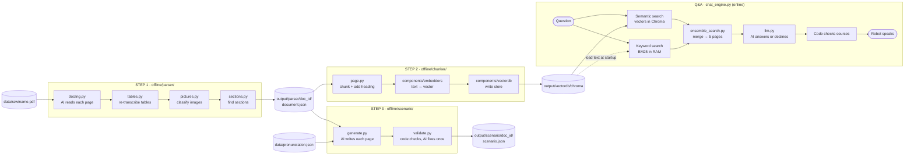
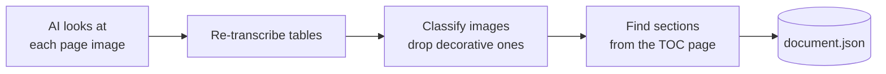
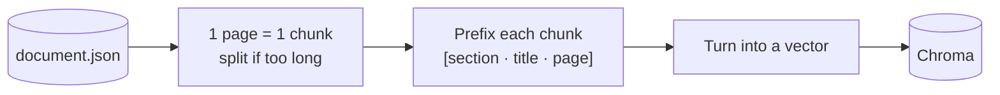
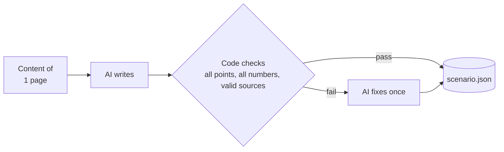
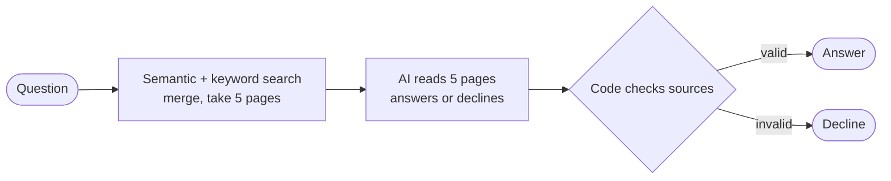

# Code architecture

Input: **one PDF slide deck**. The system does two things: **writes a script** for the robot to present the deck, and **answers audience questions** based on the slides.

## `src/` layout

```
src/
├── offline/                  RUNS AHEAD OF TIME (offline)
│   ├── parser/                 Step 1 — read the slides
│   │   ├── cli.py                command entry point
│   │   ├── base.py               skeleton: read pages → tables → images → sections → write file
│   │   ├── variants/docling.py   AI reads each page image
│   │   ├── tables.py             re-transcribe tables
│   │   ├── pictures.py           classify images, drop decorative ones
│   │   ├── sections.py           find sections from the table-of-contents page
│   │   └── vlm.py                shared helpers for calling the vision model
│   ├── chunker/                Step 2 — chunk + store
│   │   ├── cli.py                command: chunk → embed → write to Chroma
│   │   ├── base.py · factory.py  skeleton + pick a chunking strategy
│   │   └── variants/page.py      1 page = 1 chunk, split if too long
│   └── scenario/               Step 3 — write the script
│       ├── cli.py                command entry point
│       ├── generate.py           AI writes each page
│       └── validate.py           code checks the script
├── chat_engine.py            Q&A (online)
├── components/               swappable parts
│   ├── embedders/              text → vector (cached)
│   ├── vectordb/               Chroma store
│   └── keyword_search.py       keyword search (BM25)
├── utils/                    shared helpers
│   ├── config.py               paths, .env
│   ├── llm.py                  calls the LLM
│   ├── ensemble_search.py      merges the two searches (RRF)
│   └── syllables.py · tokens.py · filters.py · vectors.py
├── models/                   data shapes
│   ├── parsed_document.py      document.json
│   ├── kb_chunk.py             chunks, search hits
│   ├── scenario.py             script
│   └── runtime.py              config + answer
├── evaluation/               search quality — eval.py · tune.py
├── prompts/                  prompts sent to the AI (.md)
└── output/                   generated files
```

## Full flow (offline + online)



- Steps 1, 2, 3 run ahead of time. Command: `bash scripts/run_deck.sh data/raw/<name>.pdf`
- Q&A **reads only the Chroma store**.
- Nothing uses `scenario.json` yet: text-to-speech (TTS) is not built.

## Step 1 — Read the slides · `src/offline/parser/`



Output: each page is a list of blocks (title, text, table, image), e.g. `p007.b03` = page 7, block 3.

## Step 2 — Chunk + store · `src/offline/chunker/`



The store holds only **chunk text + vector + 4 labels** (`doc_id`, `page_no`, `section_id`, `content_type`).

## Step 3 — Write the script · `src/offline/scenario/`



Sections run in parallel; pages within a section run in order. Unchanged pages are reused.

## Q&A · `src/chat_engine.py`



If the AI call fails, the robot says a generic line (in Vietnamese): *"can't answer right now, noting it for the instructor"*.

## What to rerun after a change

| You change | Rerun |
|---|---|
| slide-reading prompt | Step 1 `--redo` → 2 → 3 |
| chunking | Step 2 |
| script prompt | Step 3 |

Every step is cached; nothing unchanged costs API calls. **After changing `document.json`, rerun Step 2**, otherwise Q&A keeps using the old store.

## Commands

```bash
bash scripts/run_deck.sh data/raw/thoi_gian_lam_viec.pdf                # all offline steps
python scripts/try_ask.py thoi_gian_lam_viec "làm thêm giờ tính sao"    # ask a test question
```
